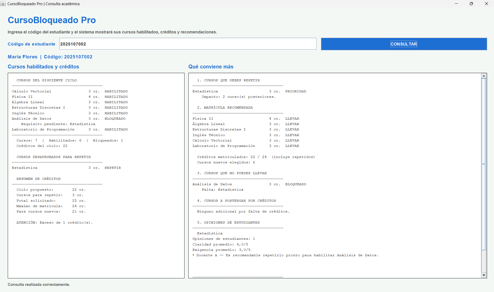

#  CursoBloqueado Pro

### Sistema de orientación académica mediante estructuras de datos

**Universidad:** Universidad Nacional de Juliaca (UNAJ)  
**Curso:** Algoritmos y Estructuras de Datos II  
**Estudiante:** Aderly Gerson Arrosquipa Ccari  
**Docente:** Ing. Noe Wilber Tipo Mamani  
**Lenguaje:** Java  
**Interfaz gráfica:** Java Swing — IntelliJ IDEA

---

##  Descripción del proyecto

**CursoBloqueado Pro** es una aplicación desarrollada en Java Swing que ayuda a los estudiantes universitarios a planificar su matrícula cuando han desaprobado una o más asignaturas.

El sistema identifica los cursos habilitados, los cursos bloqueados por prerrequisitos y las asignaturas que deben repetirse. Asimismo, calcula los créditos académicos y genera recomendaciones para organizar la matrícula sin superar el límite permitido.

El proyecto aplica estructuras de datos como **grafos dirigidos, búsqueda en profundidad (DFS), árboles binarios de búsqueda (ABB) y listas enlazadas**.


## 🖥️ Vista de la aplicación

La siguiente imagen muestra la interfaz de CursoBloqueado Pro desarrollada en Java Swing.



**Ejemplo:** Consulta del estudiante 2025107002, con cursos habilitados, créditos y recomendaciones académicas.
  

##  Objetivo general

Desarrollar una aplicación de orientación académica que permita analizar los cursos desaprobados, verificar los prerrequisitos y recomendar una distribución de asignaturas considerando los créditos disponibles.

##  Ejemplo de funcionamiento

El sistema considera siete asignaturas que suman **22 créditos**.

| N.º | Asignatura | Créditos |
|---|---|---:|
| 1 | Cálculo Vectorial | 3 |
| 2 | Física II | 4 |
| 3 | Álgebra Lineal | 3 |
| 4 | Estructuras Discretas I | 3 |
| 5 | Inglés Técnico | 3 |
| 6 | Análisis de Datos | 3 |
| 7 | Laboratorio de Programación | 3 |
| | **TOTAL** | **22** |

**Límite máximo de matrícula del ejemplo: 24 créditos.**

### Caso práctico: estudiante `2025107002`

La estudiante ha desaprobado **Estadística**, asignatura de 3 créditos que necesita repetir.

Si intentara matricular los siete cursos del ciclo y repetir Estadística, tendría:

| Concepto | Créditos |
|---|---:|
| Cursos del ciclo | 22 |
| Estadística (repetición) | 3 |
| Total solicitado | 25 |
| Límite permitido | 24 |
| **Exceso** | **1** |

Además, **Análisis de Datos** está bloqueado porque requiere haber aprobado Estadística.

Por lo tanto, el sistema recomienda repetir Estadística y matricular los seis cursos habilitados, con un total de **22 créditos**.

##  Estructuras de datos implementadas

### 1. Grafo dirigido y algoritmo DFS

**Archivo:** `src/estructuras/GrafoCursos.java`

El grafo representa las relaciones de prerrequisitos entre asignaturas.

Cada vértice representa un curso y cada arista dirigida indica que una asignatura es requisito de otra.

Ejemplo:

`Estadística → Análisis de Datos → Proyecto Integrador`

El algoritmo **DFS (Depth-First Search)** recorre las dependencias académicas para identificar los cursos posteriores que pueden verse afectados por una desaprobación.

### 2. Árbol Binario de Búsqueda (ABB)

**Archivo:** `src/estructuras/ArbolEstudiantes.java`

Se utiliza para organizar y localizar estudiantes mediante sus códigos universitarios.

La búsqueda compara el código ingresado con los nodos del árbol para encontrar el registro correspondiente.

### 3. Lista enlazada

**Archivo:** `src/estructuras/ListaOpiniones.java`

Permite almacenar opiniones y recomendaciones de estudiantes sobre las asignaturas y sus docentes.

Cada nodo contiene información de una opinión y una referencia al siguiente nodo.

##  Tecnologías utilizadas

- Java — JDK 17 o superior.
- Java Swing — interfaz gráfica.
- IntelliJ IDEA — entorno de desarrollo.
- GUI Designer (`.form`) — diseño visual de la interfaz.
- Programación orientada a objetos.
- Estructuras de datos implementadas en Java.

##  Instalación y ejecución

1. Clonar o descargar el repositorio.
2. Abrir la carpeta del proyecto en IntelliJ IDEA.
3. Configurar **JDK 17 o superior**.
4. Marcar la carpeta `src` como **Sources Root**.
5. Ingresar a **Settings → Editor → GUI Designer**.
6. Seleccionar **Generate GUI into Binary class files**.
7. Ejecutar **Build → Rebuild Project**.
8. Ejecutar la clase `Main.java`.

**Nota:** El archivo `src/frmVentana/frmPrincipal.form` contiene el diseño visual de la interfaz.

##  Códigos de estudiantes para pruebas

```text
2025107001
2025107002
2025107003
2025107004
2025107005
```

**Código recomendado para la demostración:** `2025107002`.

Este ejemplo permite observar un curso desaprobado, el bloqueo de una asignatura por prerrequisitos y una recomendación de matrícula.

##  Funcionalidades principales

- Consulta académica mediante código universitario.
- Identificación de cursos aprobados y desaprobados.
- Verificación de prerrequisitos.
- Detección de cursos bloqueados.
- Cálculo de créditos académicos.
- Recomendaciones para priorizar asignaturas.
- Visualización de opiniones de otros estudiantes.
- Interfaz gráfica desarrollada en Java Swing.

##  Conclusiones

CursoBloqueado Pro demuestra cómo las estructuras de datos pueden aplicarse a una problemática universitaria.

La integración de grafos dirigidos y DFS permite analizar dependencias entre asignaturas, mientras que el árbol binario de búsqueda facilita la consulta de estudiantes y la lista enlazada organiza sus opiniones.

El resultado es una herramienta educativa que orienta la planificación académica de manera clara y comprensible.

---

## 👨‍💻 Autor

**Aderly Gerson Arrosquipa Ccari**  
Universidad Nacional de Juliaca — UNAJ  
Algoritmos y Estructuras de Datos II

**Docente:** Ing. Noe Wilber Tipo Mamani

**Repositorio:** https://github.com/jhaderlyCo/CursoBloqueadoPro

---

*Proyecto académico desarrollado con datos ficticios para fines educativos. Las recomendaciones no sustituyen las normas oficiales de matrícula de la universidad.*
